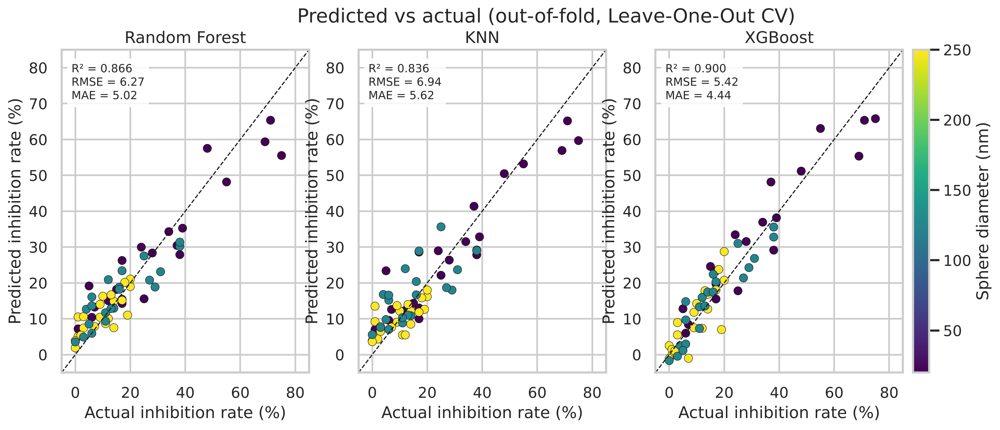
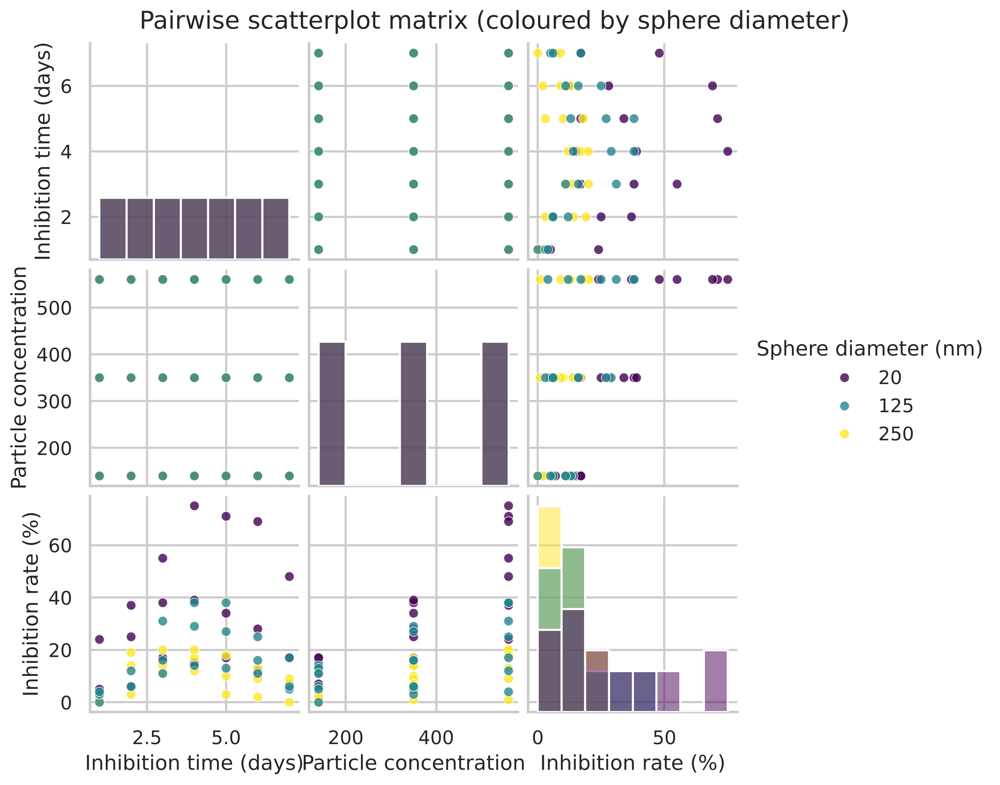
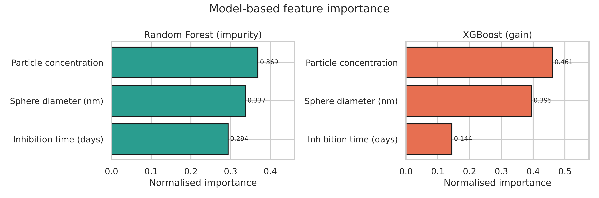

# Regression-Based ML of the Tumour-Cell Inhibition Rate of Hydroxyapatite Nanoparticles

Predicting the tumour-cell inhibition rate (%) of spherical hydroxyapatite (HAp) nanoparticles from three physicochemical inputs, using **Random Forest**, **K-Nearest Neighbours** and **XGBoost** regression with cross-validation.

Course project for **MM3330 Non-Metallic Materials (Biomaterials section), 2026**.



## Contents

- [Dataset](#dataset)
- [Method](#method)
- [Results](#results)
- [Repository structure](#repository-structure)
- [How to run](#how-to-run)
- [Figures](#figures)
- [Reference](#reference)

## Dataset

`data/hap_inhibition_dataset.csv`: 63 samples, full factorial design, no missing values.

| Column | Role | Levels |
|---|---|---|
| Sphere diameter (nm) | input | 20, 125, 250 |
| Inhibition time (days) | input | 1 – 7 |
| Particle concentration | input | 140, 350, 560 |
| Inhibition rate (%) | target | 0 – 75 |

## Method

| Step | Details |
|---|---|
| Exploration | Summary statistics, Pearson correlation, pairwise scatterplots |
| Models | `RandomForestRegressor`, `KNeighborsRegressor` (with `StandardScaler`), `XGBRegressor` |
| Tuning | Grid search with inner 5-fold CV, optimising RMSE |
| Evaluation | Repeated 5-fold CV (10 repeats, 50 splits) and Leave-One-Out CV |
| Metrics | R², RMSE, MAE |
| Interpretation | Impurity / gain importance (RF, XGBoost), permutation importance (all models), partial dependence, response surfaces |

Random seed is fixed at `42` for reproducibility.

## Results

| Model | R² (repeated 5-fold) | RMSE % | MAE % | LOOCV R² | LOOCV RMSE % | LOOCV MAE % |
|---|---|---|---|---|---|---|
| Random Forest | 0.769 ± 0.298 | 6.75 ± 1.72 | 5.45 ± 1.36 | 0.866 | 6.27 | 5.02 |
| KNN | 0.755 ± 0.248 | 6.94 ± 1.76 | 5.63 ± 1.45 | 0.836 | 6.94 | 5.62 |
| **XGBoost** | **0.856 ± 0.096** | **5.53 ± 1.01** | **4.54 ± 0.86** | **0.900** | **5.42** | **4.44** |

Feature importance (normalised):

| Feature | Random Forest | XGBoost (gain) |
|---|---|---|
| Particle concentration | 0.369 | 0.461 |
| Sphere diameter | 0.337 | 0.395 |
| Inhibition time | 0.294 | 0.144 |

Full tables are in [`outputs/tables/`](outputs/tables).

## Repository structure

```
.
├── data/
│   └── hap_inhibition_dataset.csv
├── src/
│   └── hap_inhibition_ml.py
├── outputs/
│   ├── figures/          # 12 PNG figures, 300 dpi
│   └── tables/           # summary stats, correlations, model comparison, importances
├── requirements.txt
└── README.md
```

## How to run

```bash
git clone https://github.com/Mahith2203/Regression-Based-ML-of-the-Tumour-Cell-Inhibition-Rate-of-Hydroxyapatite-Nanoparticles.git
cd Regression-Based-ML-of-the-Tumour-Cell-Inhibition-Rate-of-Hydroxyapatite-Nanoparticles
pip install -r requirements.txt
python src/hap_inhibition_ml.py
```

Optional arguments:

```bash
python src/hap_inhibition_ml.py --data path/to/data.csv --out path/to/outputs
```

Runtime is about one minute on a laptop CPU. Tested with Python 3.13, scikit-learn 1.9, XGBoost 3.4.

**Google Colab:** upload `src/hap_inhibition_ml.py` and the CSV, then run
`!python hap_inhibition_ml.py --data hap_inhibition_dataset.csv --out outputs`.

## Figures

| File | Content |
|---|---|
| `fig0_correlation_heatmap.png` | Pearson correlation matrix |
| `fig1_pairplot.png` | Pairwise scatterplot matrix |
| `fig2_inputs_vs_target.png` | Each input vs inhibition rate |
| `fig3_time_course_interactions.png` | Inhibition vs time by diameter and concentration |
| `fig4_comparison_table.png` | Model comparison table |
| `fig5_metric_comparison.png` | R², RMSE, MAE bars and fold-wise R² |
| `fig6_predicted_vs_actual.png` | Out-of-fold predicted vs actual |
| `fig7_residuals.png` | Residual plots |
| `fig8_feature_importance_RF_XGB.png` | RF and XGBoost feature importance |
| `fig9_permutation_importance.png` | Permutation importance, all models |
| `fig10_response_surface.png` | XGBoost response surface per diameter |
| `fig11_partial_dependence.png` | Partial dependence curves |

<p align="center">
  
  
</p>

## Reference

Liu, Z. *et al.* Machine learning on properties of multiscale multisource hydroxyapatite nanoparticles datasets with different morphologies and sizes. *npj Computational Materials* **7**, 142 (2021). https://doi.org/10.1038/s41524-021-00618-1
