# Regression-Based ML of the Tumour-Cell Inhibition Rate of Hydroxyapatite Nanoparticles


Supervised regression of the **in vitro tumour-cell inhibition rate (%)** of spherical hydroxyapatite nanoparticles (HAp, Ca₁₀(PO₄)₆(OH)₂) as a function of **sphere diameter**, **inhibition time** and **particle concentration**. Three regressors are compared: **Random Forest (RF)**, **K-Nearest Neighbours (KNN)** and **Extreme Gradient Boosting (XGBoost)**. Each is tuned by grid search and evaluated with **repeated 5-fold** and **leave-one-out** cross-validation.

Course project · MM3330 Non-Metallic Materials (Biomaterials), 2026

<p align="center">
  
</p>

---

## Table of contents

1. [Problem formulation](#1-problem-formulation)
2. [Dataset](#2-dataset)
3. [Exploratory data analysis](#3-exploratory-data-analysis)
4. [Methodology](#4-methodology)
5. [Results](#5-results)
6. [Feature attribution](#6-feature-attribution)
7. [Model response](#7-model-response)
8. [Limitations of the data](#8-limitations-of-the-data)
9. [Reproducing the results](#9-reproducing-the-results)
10. [Repository structure](#10-repository-structure)
11. [Reference](#11-reference)

---

## 1. Problem formulation

The task is to learn a mapping

$$
\hat{y} = f(d,\; t,\; c), \qquad f : \mathbb{R}^3 \rightarrow \mathbb{R}
$$

| Symbol | Variable | Unit | Type |
|---|---|---|---|
| $d$ | Sphere diameter | nm | input |
| $t$ | Inhibition time | days | input |
| $c$ | Particle concentration | as given in dataset | input |
| $y$ | Tumour-cell inhibition rate | % | target |

The target is a continuous quantity, so this is a regression problem. Model quality is judged on held-out data only.

---

## 2. Dataset

[`data/hap_inhibition_dataset.csv`](data/hap_inhibition_dataset.csv) is a subset of the experimental anti-tumour data collated in Liu *et al.* (2021).

- **63 samples**, **3 inputs**, **1 target**, **no missing values**
- **Full factorial design:** 3 diameters × 7 time points × 3 concentrations = 63

### 2.1 Summary statistics

| Variable | Count | Mean | SD | Min | Q1 | Median | Q3 | Max | Skewness |
|---|---|---|---|---|---|---|---|---|---|
| Sphere diameter (nm) | 63 | 131.67 | 94.77 | 20 | 20 | 125 | 250 | 250 | 0.11 |
| Inhibition time (days) | 63 | 4.00 | 2.02 | 1 | 2 | 4 | 6 | 7 | 0.00 |
| Particle concentration | 63 | 350.00 | 172.84 | 140 | 140 | 350 | 560 | 560 | 0.00 |
| **Inhibition rate (%)** | 63 | **18.59** | **17.27** | **0** | **6** | **14** | **25** | **75** | **1.60** |

The target is right-skewed (skewness 1.60): most values fall below 25%, and a few high values occur at the smallest diameter.

### 2.2 Design matrix

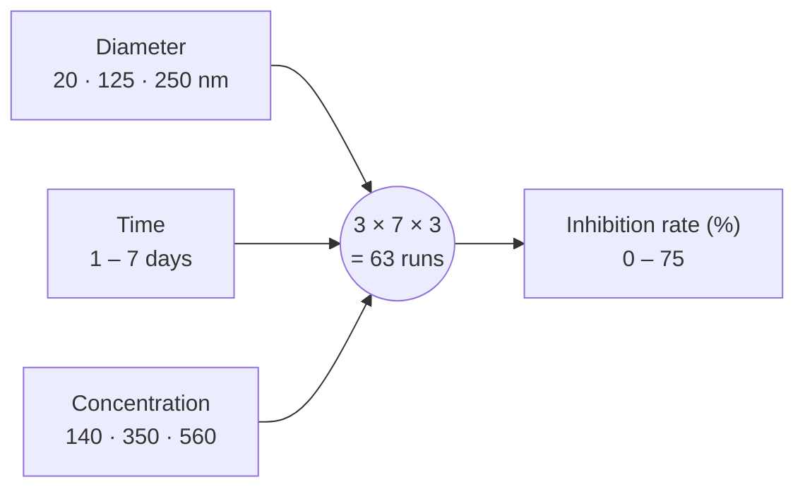

---

## 3. Exploratory data analysis

### 3.1 Pearson correlation with the target

| Input | r with inhibition rate |
|---|---|
| Particle concentration | **+0.542** |
| Sphere diameter | **−0.489** |
| Inhibition time | +0.168 |

All inputs are mutually uncorrelated (r = 0.000) because the design is factorial.

<p align="center">
  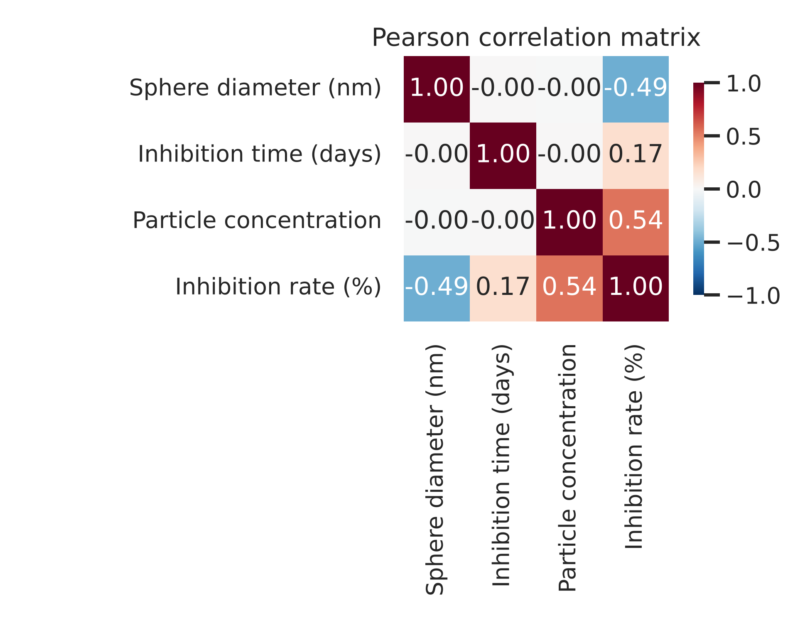
</p>

### 3.2 Pairwise scatterplots

<p align="center">
  
</p>

<p align="center">
  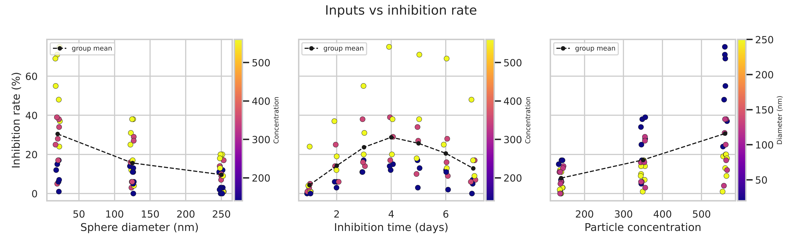
</p>

### 3.3 Group means of the measured data

**Mean inhibition rate (%) by diameter and concentration** (averaged over 7 days):

| Diameter \ Concentration | 140 | 350 | 560 |
|---|---|---|---|
| 20 nm | 10.7 | 26.6 | **54.1** |
| 125 nm | 8.6 | 14.7 | 23.6 |
| 250 nm | 4.4 | 10.3 | 14.3 |

**Mean inhibition rate (%) by day** (averaged over diameter and concentration):

| Day | 1 | 2 | 3 | 4 | 5 | 6 | 7 |
|---|---|---|---|---|---|---|---|
| Mean (%) | 4.3 | 14.2 | 23.7 | **28.8** | 25.7 | 20.6 | 12.9 |

**Maximum measured inhibition at each diameter:**

| Diameter | Max (%) | Day | Concentration |
|---|---|---|---|
| 20 nm | 75 | 4 | 560 |
| 125 nm | 38 | 4 | 560 |
| 250 nm | 20 | 3 | 560 |

<p align="center">
  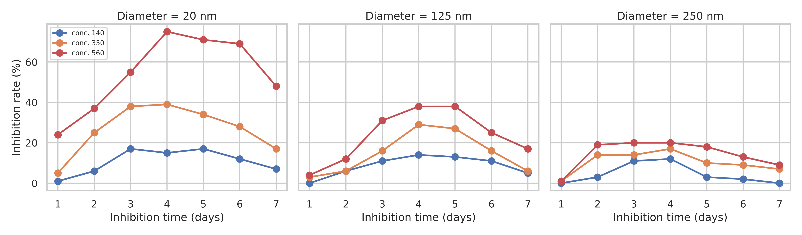
</p>

---

## 4. Methodology

### 4.1 Pipeline

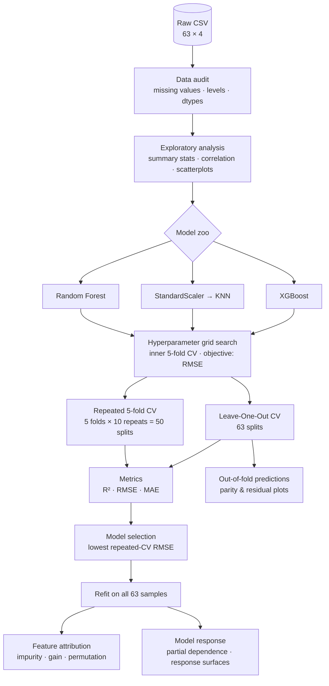

### 4.2 Models and hyperparameter search

| Model | Preprocessing | Search space | Selected |
|---|---|---|---|
| Random Forest | none (scale-invariant) | `n_estimators` {300}, `max_depth` {None, 6}, `min_samples_leaf` {1, 2, 3}, `max_features` {1.0, 0.67} | 300 trees, depth None, leaf 1, max_features 0.67 |
| KNN | `StandardScaler` (z-score) | `n_neighbors` {2, 3, 4, 5, 7, 9}, `weights` {uniform, distance}, `p` {1, 2} | k = 4, distance-weighted, Manhattan (p = 1) |
| XGBoost | none | `n_estimators` {200, 500}, `learning_rate` {0.03, 0.1}, `max_depth` {2, 3, 4}, `subsample` {0.8, 1.0} | 200 trees, η = 0.1, depth 2, subsample 0.8 |

KNN is distance-based, so its features are standardised inside the pipeline. This means the scaler is fit only on each training fold, so no information leaks from the test fold.

### 4.3 Cross-validation schemes

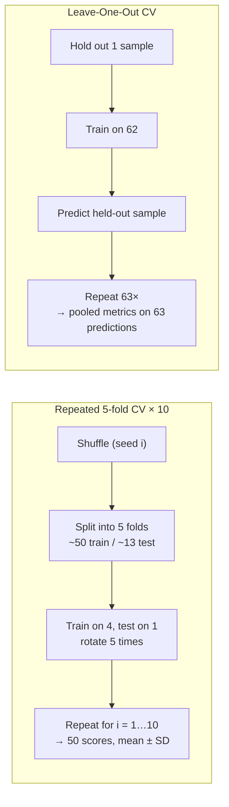

| Scheme | Splits | Train size | Test size | Reported as |
|---|---|---|---|---|
| Repeated 5-fold | 50 | ~50 | ~13 | mean ± SD across folds |
| Leave-One-Out | 63 | 62 | 1 | pooled over all out-of-fold predictions |

### 4.4 Evaluation metrics

$$
R^2 = 1 - \frac{\sum_i (y_i - \hat{y}_i)^2}{\sum_i (y_i - \bar{y})^2}
\qquad
\mathrm{RMSE} = \sqrt{\frac{1}{n}\sum_i (y_i - \hat{y}_i)^2}
\qquad
\mathrm{MAE} = \frac{1}{n}\sum_i \lvert y_i - \hat{y}_i \rvert
$$

RMSE and MAE are in percentage points of inhibition rate.

---

## 5. Results

### 5.1 Model comparison

| Model | R² (5-fold ×10) | RMSE (5-fold ×10) | MAE (5-fold ×10) | Train R² | LOOCV R² | LOOCV RMSE | LOOCV MAE |
|---|---|---|---|---|---|---|---|
| Random Forest | 0.769 ± 0.298 | 6.75 ± 1.72 | 5.45 ± 1.36 | 0.977 | 0.866 | 6.27 | 5.02 |
| KNN | 0.755 ± 0.248 | 6.94 ± 1.76 | 5.63 ± 1.45 | 1.000 | 0.836 | 6.94 | 5.62 |
| **XGBoost** | **0.856 ± 0.096** | **5.53 ± 1.01** | **4.54 ± 0.86** | 0.972 | **0.900** | **5.42** | **4.44** |

- **Selection rule:** lowest mean RMSE under repeated 5-fold CV. **XGBoost** is selected.
- **Ranking:** XGBoost leads on every held-out metric under both CV schemes.
- **Variance:** the fold-to-fold SD of R² is 0.096 for XGBoost, compared with 0.248 for KNN and 0.298 for RF.
- **Train–test gap:** train R² minus LOOCV R² is 0.072 for XGBoost, 0.111 for RF and 0.164 for KNN.

<p align="center">
  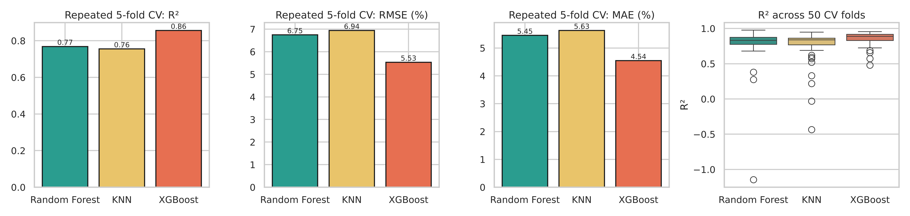
</p>

### 5.2 Parity plots (out-of-fold, LOOCV)

<p align="center">
  
</p>

### 5.3 Residuals

<p align="center">
  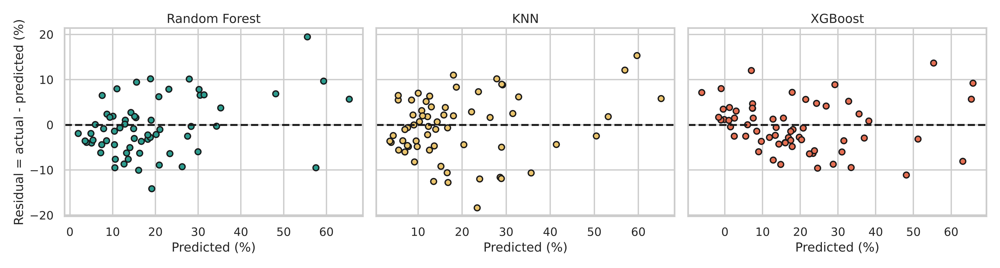
</p>

---

## 6. Feature attribution

Three complementary measures are used:

- **Impurity importance (RF):** the mean decrease in squared error from splits on each feature, normalised to sum to 1.
- **Gain importance (XGBoost):** the mean loss reduction from splits on each feature, normalised to sum to 1.
- **Permutation importance (all models):** the mean drop in R² when a feature's values are randomly shuffled, over 50 repeats. This measure works for any model.

| Feature | RF impurity | XGBoost gain | Perm. RF | Perm. KNN | Perm. XGBoost |
|---|---|---|---|---|---|
| Particle concentration | **0.369** | **0.461** | **0.901 ± 0.215** | **0.973 ± 0.234** | **0.902 ± 0.205** |
| Sphere diameter | 0.337 | 0.395 | 0.850 ± 0.190 | 0.939 ± 0.216 | 0.859 ± 0.183 |
| Inhibition time | 0.294 | 0.144 | 0.520 ± 0.114 | 0.631 ± 0.133 | 0.547 ± 0.104 |

Every attribution method gives the same ranking: **concentration > diameter > time**.

<p align="center">
  
</p>
<p align="center">
  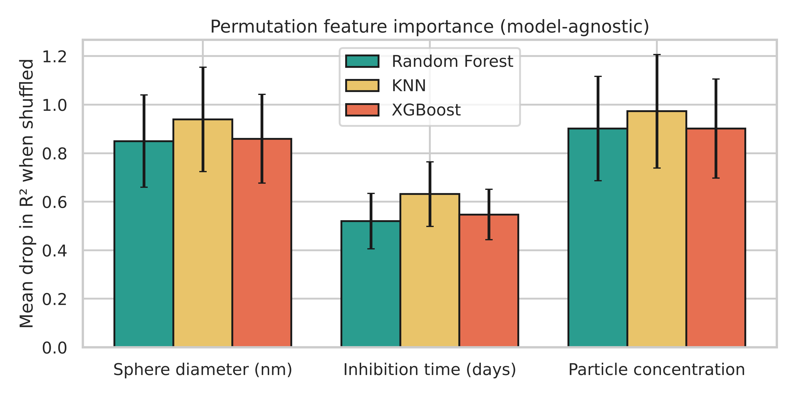
</p>

---

## 7. Model response

**Partial dependence:** the average model prediction as one input is swept across its range, with the other two inputs held at their observed values.

<p align="center">
  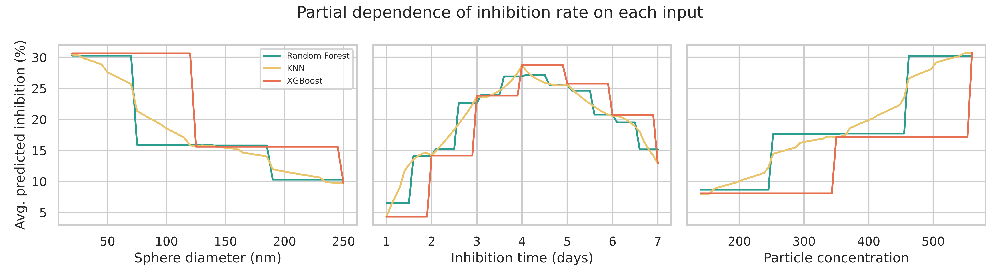
</p>

**Response surfaces:** XGBoost predictions over time × concentration, shown separately at each diameter.

<p align="center">
  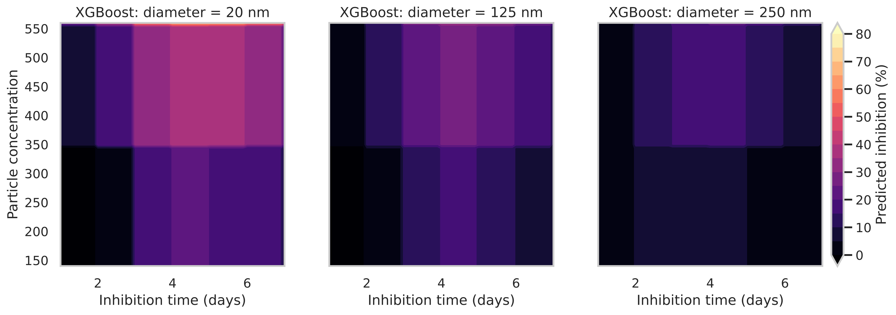
</p>

---

## 8. Limitations of the data

| Limitation | Consequence |
|---|---|
| n = 63 | Fold-level metrics have high variance, so the SDs are reported alongside the means. |
| Diameter and concentration have only 3 levels each | Tree models produce step-like outputs between levels, so predictions at untested values (e.g. 60 nm) are interpolation or extrapolation, not measurement. |
| Single morphology (spheres) | Results don't transfer to rod, needle or plate HAp. |
| One target per condition, no replicates | Experimental noise can't be separated from model error. |

---

## 9. Reproducing the results

```bash
git clone https://github.com/Mahith2203/Regression-Based-ML-of-the-Tumour-Cell-Inhibition-Rate-of-Hydroxyapatite-Nanoparticles.git
cd Regression-Based-ML-of-the-Tumour-Cell-Inhibition-Rate-of-Hydroxyapatite-Nanoparticles
pip install -r requirements.txt
python src/hap_inhibition_ml.py
```

Optional arguments:

```bash
python src/hap_inhibition_ml.py --data path/to/data.csv --out path/to/outputs
```

- **Runtime:** about 1 minute on a laptop CPU.
- **Seed:** `42` everywhere.
- **Tested with:** Python 3.13, NumPy 2.5, pandas 3.0, scikit-learn 1.9, XGBoost 3.4, matplotlib 3.11, seaborn 0.13.

**Google Colab:** upload `src/hap_inhibition_ml.py` and the CSV, then run

```python
!pip install xgboost seaborn
!python hap_inhibition_ml.py --data hap_inhibition_dataset.csv --out outputs
```

---

## 10. Repository structure

```
.
├── data/
│   └── hap_inhibition_dataset.csv        # 63 × 4 experimental dataset
├── src/
│   └── hap_inhibition_ml.py              # full pipeline: EDA → tuning → CV → plots
├── outputs/
│   ├── figures/
│   │   ├── fig0_correlation_heatmap.png
│   │   ├── fig1_pairplot.png
│   │   ├── fig2_inputs_vs_target.png
│   │   ├── fig3_time_course_interactions.png
│   │   ├── fig4_comparison_table.png
│   │   ├── fig5_metric_comparison.png
│   │   ├── fig6_predicted_vs_actual.png
│   │   ├── fig7_residuals.png
│   │   ├── fig8_feature_importance_RF_XGB.png
│   │   ├── fig9_permutation_importance.png
│   │   ├── fig10_response_surface.png
│   │   └── fig11_partial_dependence.png
│   └── tables/
│       ├── table1_summary_statistics.csv
│       ├── table2_correlation.csv
│       ├── table3_model_comparison.csv
│       ├── table4_feature_importance.csv
│       └── model_params.csv
├── requirements.txt
└── README.md
```

---

## 11. Reference

1. Liu, Z. *et al.* Machine learning on properties of multiscale multisource hydroxyapatite nanoparticles datasets with different morphologies and sizes. *npj Computational Materials* **7**, 142 (2021). https://doi.org/10.1038/s41524-021-00618-1
2. Pedregosa, F. *et al.* Scikit-learn: machine learning in Python. *J. Mach. Learn. Res.* **12**, 2825–2830 (2011).
3. Chen, T. & Guestrin, C. XGBoost: a scalable tree boosting system. *Proc. 22nd ACM SIGKDD*, 785–794 (2016).
4. Breiman, L. Random forests. *Mach. Learn.* **45**, 5–32 (2001).
